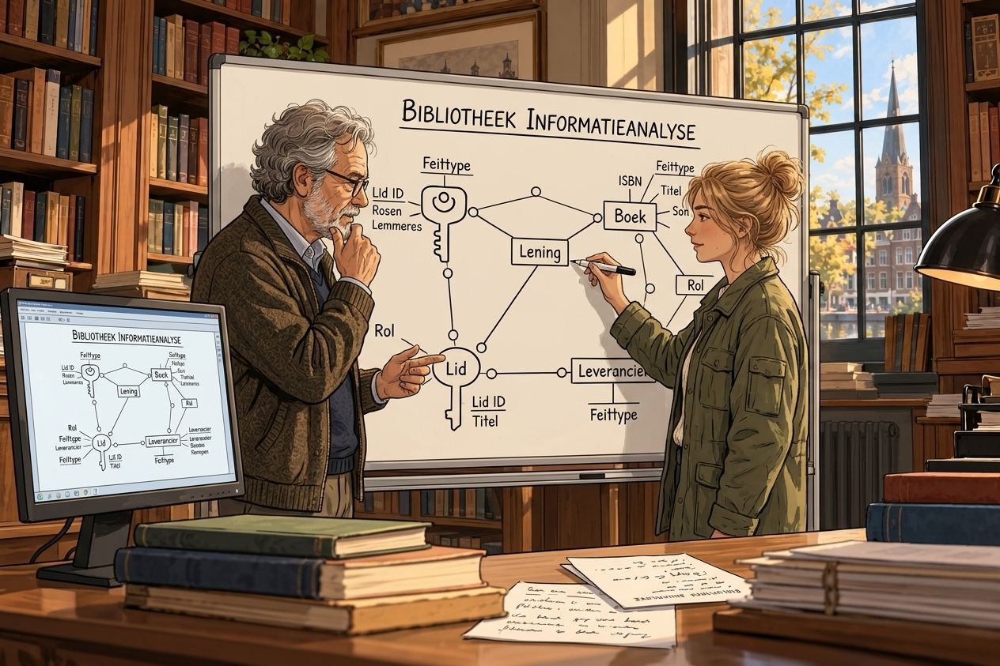

Bibliotheek Lexis
{ .lexis-kicker }

# Eerst de woorden

Waarom een snel antwoord niet hetzelfde is als een juist antwoord.
{ .lexis-sub }

## Lexis groeit

Op een doordeweekse middag zit de leeszaal van Bibliotheek Lexis vol met scholieren en studenten. Twee jaar geleden was dat anders. Het aantal leden onder de 26 is sindsdien met ongeveer een derde gegroeid, en Floris, die de oude leden bij naam kent, ziet steeds meer gezichten die hij niet kan plaatsen. Waarom ze komen weet niemand precies; misschien om de werkplekken, de gratis wifi of de boekenclub die jongeren zelf zijn begonnen. Lexis staat daarin niet alleen: volgens [de NOS](https://nos.nl/artikel/2630399-meer-locaties-meer-bezoekers-en-meer-leden-bibliotheek-zit-in-de-lift) steeg het aantal leden van 18 tot 30 jaar landelijk in 2025 met ruim een vijfde.

## Een nieuw systeem binnen bereik

Floris wil de nieuwe leden behouden. Hij neemt aan dat zij gewend zijn op hun telefoon in een paar tellen te krijgen wat ze zoeken, en dat ze afhaken als Lexis trager of minder precies antwoordt (aanname). Hij heeft plannen om het bestaande IT-systeem van Lexis volledig te vervangen door een systeem dat beter aansluit op wat de bibliotheek nodig heeft. Een paar jaar geleden leek zo'n vernieuwing voor Lexis buiten bereik. Floris denkt dat AI het nu relatief goedkoop mogelijk maakt: bij het ontwikkelen van het systeem, en daarna bij het sneller beantwoorden van vragen van leden. Die verwachting komt mede voort uit zijn eigen gebruik van ChatGPT voor teksten en losse vragen.

## Waarom ChatGPT soms de mist in gaat

Floris gebruikt ChatGPT al een tijd, vooral voor teksten en losse vragen. Meestal gaat dat goed, en juist daardoor viel het hem op toen het een keer misging. Hij liet een alinea voor de gemeente verbeteren en kreeg een tekst terug die zo vanzelfsprekend klonk dat hij hem bijna ongelezen had doorgestuurd. Bij nalezen bleek er een bewering in te staan die niet klopte, en niets in de tekst verried dat. Een andere keer stelde hij een vraag over een auteur uit de streek, formuleerde hem daarna net iets anders, en kreeg een ander antwoord. Welk antwoord juist was, kon hij niet zien. Lag het aan het model, of aan de manier waarop hij zijn vraag stelde?

Dezelfde ervaringen die zijn belangstelling wekten, voeden nu zijn twijfel. Hij heeft nog geen grip op de technologie en weet niet hoe hij die verantwoord kan inzetten, terwijl hij er een volledige vervanging van het IT-systeem op wil baseren.

!!! verteller "Wat er op het spel staat"

    Een losse vraag aan ChatGPT is een eenvoudige opdracht, en zelfs dan is het antwoord niet betrouwbaar. Een IT-systeem laten maken is een veel complexere opdracht: het taalmodel moet dan weten wat Lexis bedoelt met elke term, elke regel en elke uitzondering. Als een eenvoudige vraag al niet zo te stellen is dat het antwoord klopt, hoe kan een taalmodel dan software maken die klopt? Bovendien zijn fouten in software moeilijker te zien dan fouten in een antwoord: ze zitten in een systeem dat gewoon lijkt te werken.

!!! entoli "Waarom hetzelfde woord iets anders kan betekenen"

    Floris loopt tegen een probleem aan waar Entoli mee begint: betekenis die niet expliciet is vastgelegd, wordt door ieder anders ingevuld, ook door een taalmodel. Entoli richt zich daarom op de definitiefase van softwareontwikkeling: vastleggen wat er bedoeld wordt, voordat er iets wordt gebouwd. Entoli legt de betekenis van een vakgebied vast in een *Canon*, het gezaghebbende semantische fundament voor dat vakgebied. Het vakgebied zelf heet in Entoli een *Knowledge Domain*.

    In deze casus is het Knowledge Domain het werk van een bibliotheek. Maar ook bijvoorbeeld fact-based datamodelling en agile development zijn Knowledge Domains. De kennis over de bibliotheek is specifiek voor één tenant, Lexis. Je kunt je ook voorstellen dat met Entoli generieke kennisspecificaties worden gemodelleerd voor bijvoorbeeld scheepvaart, afvalverwerking en andere domeinen. Zelfs Agent Development is een Knowledge Domain, wat betekent dat Entoli met zichzelf wordt gerealiseerd.

## Even overleggen met Noor

Floris heeft gehoord dat Noor, die een paar dagdelen per week aan de balie werkt, dit semester is begonnen met een vak over de architectuur van agentische systemen. Ze hebben het vaker over AI gehad, maar altijd in het algemeen en nooit over Lexis. Na sluitingstijd vraagt hij of ze even tijd heeft. Hij vertelt over zijn plan om het IT-systeem te vervangen, en over de antwoorden van ChatGPT die hij niet kon vertrouwen.

Noor luistert en legt dan uit wat ze in de eerste weken van haar vak heeft geleerd. Een taalmodel werkt met wat het meekrijgt. Waar de betekenis van een woord niet is vastgelegd, vult het model die zelf in, en dat kan elke keer anders uitvallen. Wie een model software wil laten maken, moet dus eerst vastleggen wat de woorden in die software betekenen. Die semantiek is geen detail dat later komt, maar een voorwaarde om te kunnen beginnen.

Dan haalt ze, wat aarzelend, haar notities van de balie tevoorschijn. Ze houdt al een tijd bij welke vragen terugkomen, waar leden vastlopen en waar medewerkers informatie uit hun hoofd aanvullen. Ze legt het voor als vraag: zou het kunnen dat ze binnen Lexis zelf dezelfde woorden voor verschillende dingen gebruiken?

Floris herkent het meteen, en daarmee verschuift het probleem. Wat hij bij ChatGPT ziet, gebeurt ook binnen Lexis. Een vraag krijgt een ander antwoord, afhankelijk van welke medewerker dienst heeft, omdat de betekenis van de termen die Lexis gebruikt nergens is vastgelegd (aanname, op basis van Noors balie-observaties). Medewerkers vullen die betekenis zelf in, precies zoals een taalmodel dat doet. Een nieuw systeem, door AI gebouwd, zou het probleem van Lexis niet oplossen, maar overnemen.

Noor kent een methode uit de jaren zeventig die precies daar begint: bij gewone zinnen over het domein, waaruit je afleidt welke termen er zijn en wat ze betekenen. Ze spreken af de volgende dag na sluitingstijd te beginnen met het vastleggen van de termen die Lexis gebruikt en wat daarmee bedoeld wordt. Noors notities van de balie zijn de eerste bron.

!!! entoli "Wat Floris en Noor hier doen"

    Floris en Noor beginnen met wat Entoli zelf ook eerst doet: expliciet maken welke termen er zijn en wat ze betekenen. In Entoli heet de uitkomst van zo'n werk een *Semantic Model*: de gezaghebbende structuur van *Elements* (de termen) en *Relationships* (hoe ze samenhangen) die één Canon vastlegt. Elk Element hoort bij precies één Canon, die als enige zijn definitie vastlegt.

    De methode uit de jaren zeventig is NIAM, bedacht door de Nederlandse onderzoeker G.M. Nijssen: een manier om uit gewone zinnen af te leiden wat een domein beweert. Hoe dat werkt, staat in de [Handleiding — NIAM-analyse voor beginners](https://entoli.pages.gitlab-maxia.basetide.com/entoli-canon/fact-based-data-modelling/knowledge-base/handleiding-niam-analyse.html). NIAM is niet Entoli. Het is een methode uit het kennisgebied Data Modelling, en Entoli kan de kennis daarover vastleggen in de Canon van dat kennisgebied. Die Canon is nog in concept.

